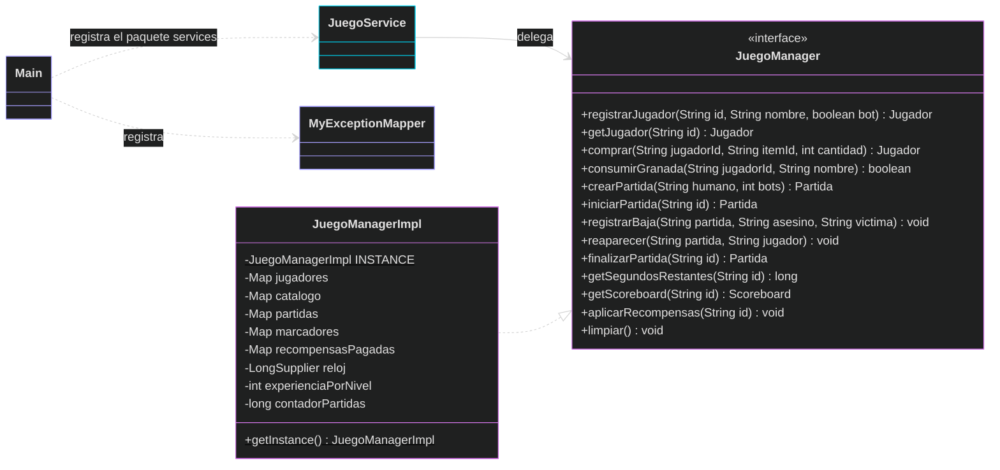
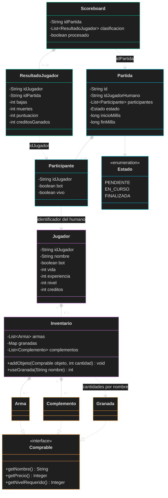

# Diagramas de clases

La estructura sigue el componente único de `DSA-Minim-Real`: servicio REST,
interfaz del gestor, implementación en memoria y modelos. Se omiten accesores,
constructores y logs. Las reglas, rutas y tareas están en el [README](../README.md).

## Componente y API

El gestor también expone las consultas de catálogo, perfiles, partidas y progresión
y la actualización de experiencia y créditos. El contrato completo está en
`JuegoManager.java`. Las operaciones públicas de la implementación se sincronizan.
Las consultas devuelven copias, y cada compra prepara el inventario antes de
guardar descuento e inventario conjuntamente.

| Contenedor | Contenido |
| --- | --- |
| `jugadores` | `Map<String, Jugador>`: perfiles por identificador. |
| `catalogo` | `Map<String, Inventario.Comprable>`: objetos por nombre. |
| `partidas` | `Map<String, Partida>`: partidas y su estado actual. |
| `marcadores` | `Map<String, Scoreboard>`: un marcador por partida. |
| `recompensasPagadas` | `Map<String, Set<String>>`: jugadores pagados en cada partida. |

Partidas y resultados se actualizan directamente dentro del mismo gestor.
No se necesitan `PartidaListener`, gestores que deleguen entre sí ni un segundo
registro de copias de partidas para poder validar recompensas.

## Modelos del juego

`Comprable` es una interfaz dentro de `Inventario`; `Participante` y `Estado` están
dentro de `Partida`. Se muestran por separado para explicar sus relaciones,
pero no tienen archivos Java propios. Los perfiles gestionados empiezan con
inventario; el modelo conserva el setter que permite un inventario nulo por compatibilidad.

Los bots son participantes temporales. Las estadísticas se calculan para todos,
pero solo se actualiza la progresión de los humanos. Los pagos se registran
por partida y jugador; si un pago falla, el marcador permanece pendiente y puede
reintentarse. Los ids de partida no se reutilizan al limpiar el gestor.

## Representaciones JSON y errores

Las clases de transporte están agrupadas dentro de `JuegoService`:

| Clase anidada | Campos o contenido |
| --- | --- |
| `Perfil` | id, nombre, nivel, experiencia y créditos. |
| `Compra` | jugadorId, itemId y cantidad (1 por defecto). |
| `CrearPartida` | idJugadorHumano y numBots. |
| `Baja` | idAsesino e idVictima. |
| `Reaparicion` | idJugador. |
| `Tiempo` | idPartida y segundosRestantes. |
| `Catalogo` | Listas de armas, granadas y complementos. |
| `ContenidoInventario` | Compras y lista de granadas con nombre y cantidad. |
| `Status` | status. |

`MyExceptionMapper.ErrorEntity` conserva el JSON de error con `code` y `message`.
Se utilizan excepciones estándar, sin clases de excepción adicionales:

| Excepción | HTTP |
| --- | --- |
| `IllegalArgumentException`, `ArithmeticException` | 400 |
| `SecurityException` | 403 |
| `NoSuchElementException` | 404 |
| `IllegalStateException` | 409 |
| `WebApplicationException` | Conserva su código y cabeceras, con cuerpo JSON. |
| Excepción inesperada | 500 con mensaje genérico; detalles en logs. |

`Main` configura Jersey, Grizzly, MOXy, Swagger y los archivos de `public`.
El documento Swagger lo publica el recurso de la biblioteca. Las rutas y los
campos JSON se conservan aunque se hayan agrupado las clases Java.
