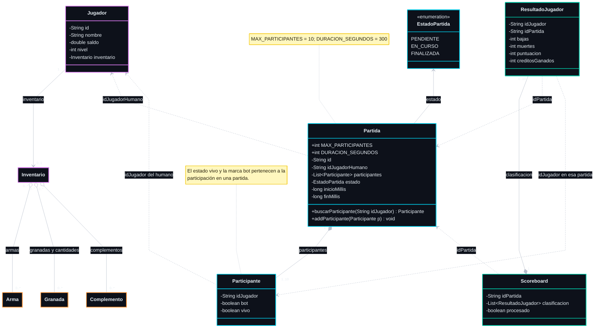
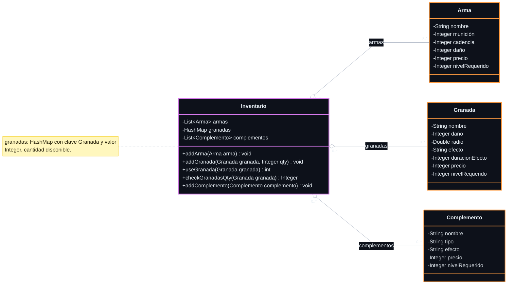
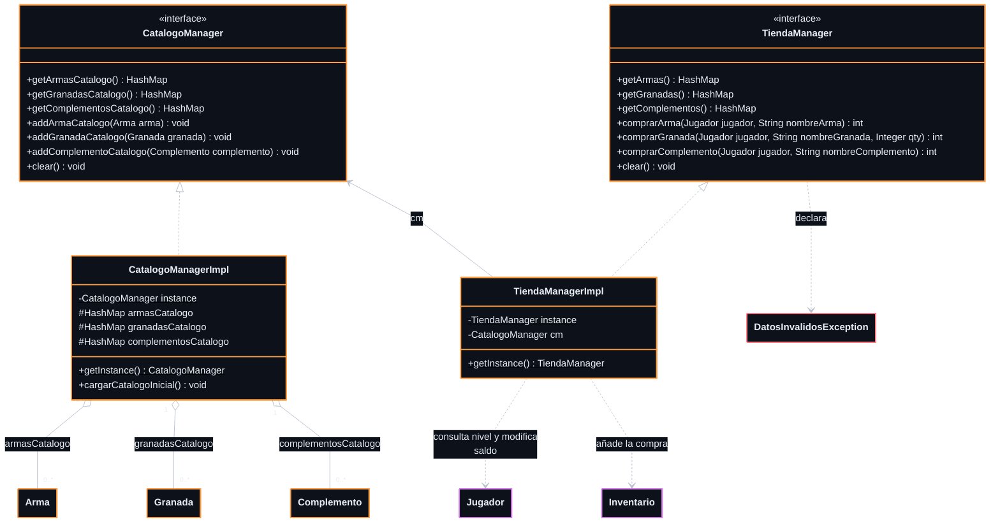
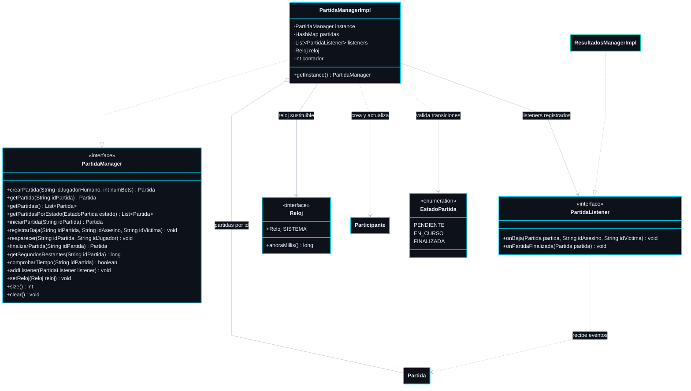
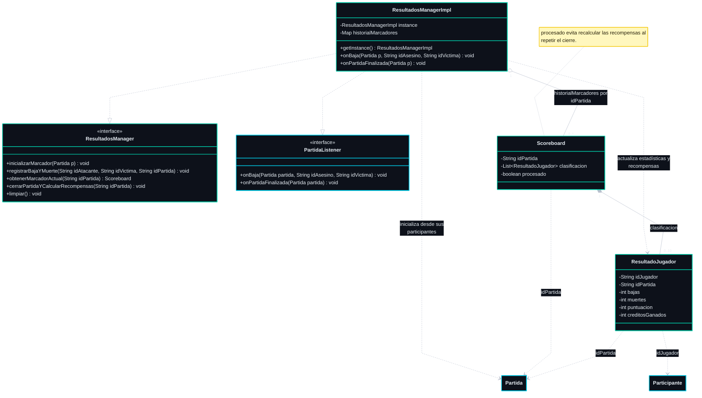
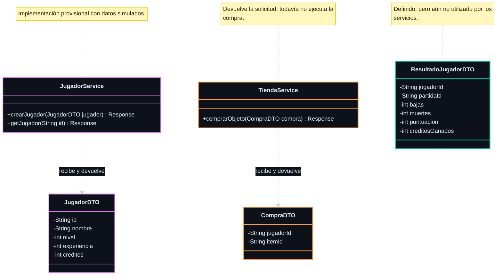
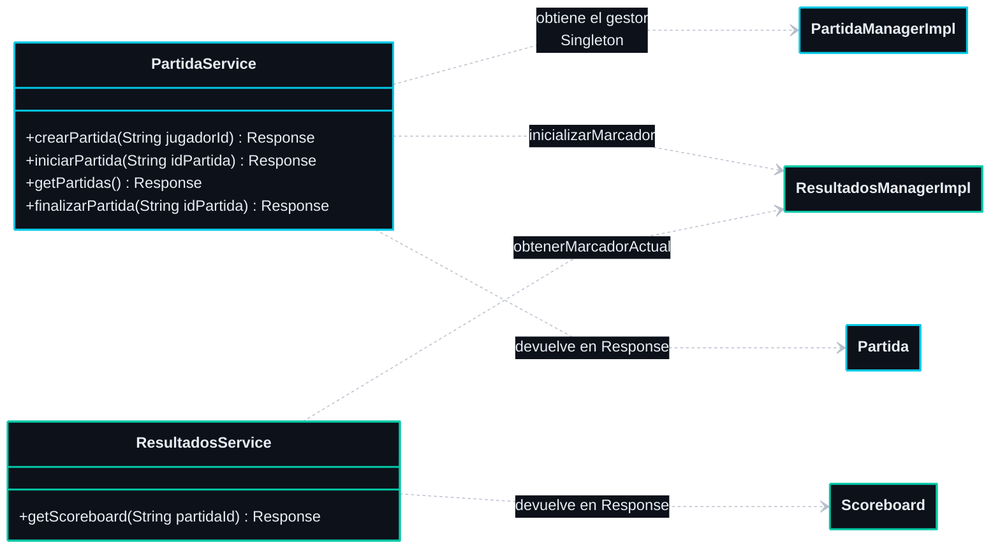
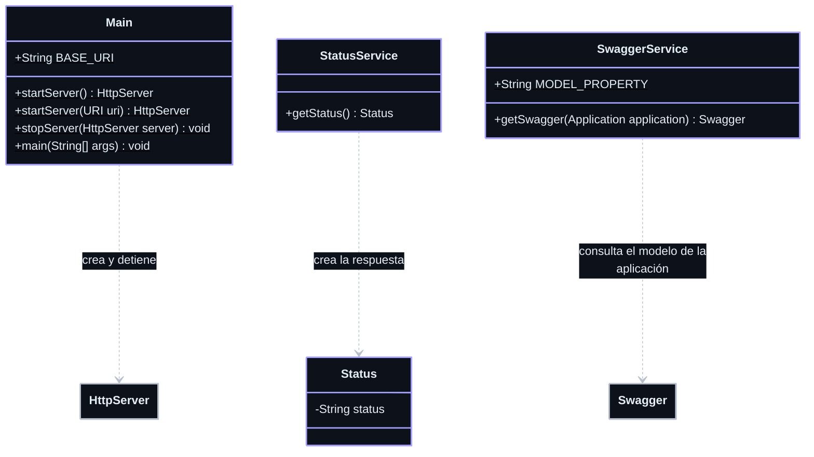
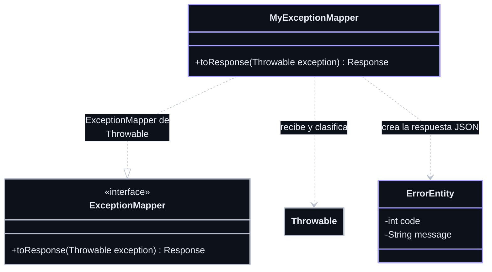
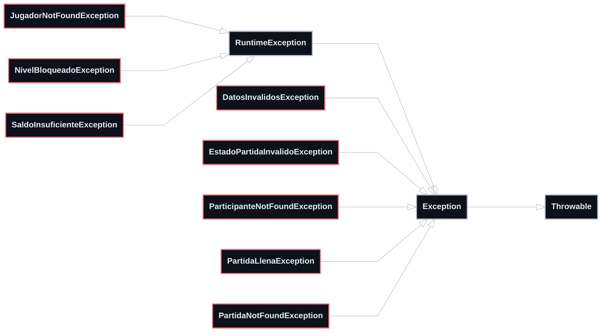

# Diagramas de clases

Diagramas Mermaid del backend de DSA-Proyecto, basados en el
[README](../README.md) y en las clases de [`src/main/java/edu/upc/dsa`](../src/main/java/edu/upc/dsa).
Representan la implementación actual; las diferencias respecto al diseño previsto
en el README se recogen al final.

Se omiten constructores, getters, setters, trazas de Log4j2 y métodos auxiliares
privados para facilitar la lectura. Las operaciones de las interfaces también
están implementadas por sus clases `*ManagerImpl`.

## Notación

| Símbolo | Significado |
| --- | --- |
| `+`, `-`, `#` | Miembro público, privado o protegido. |
| `$` al final de un miembro | Miembro estático. |
| `*--` | Composición: el objeto forma parte de otro. |
| `o--` | Agregación: agrupa objetos que pueden compartirse. |
| `-->` | Asociación con una referencia a otro objeto. |
| `..>` | Dependencia de uso o referencia mediante un identificador, según la etiqueta. |
| `..\|>` | Implementación de una interfaz. |
| `--\|>` | Herencia de una clase. |
| `0..*`, `0..1`, `1..10` | Multiplicidad de una relación. |

Los mapas se muestran como `HashMap` o `Map`, con sus claves y valores explicados
junto a cada diagrama. Las listas usan la sintaxis genérica de Mermaid (`List~Tipo~`).

### Colores

La paleta sigue el estilo de la imagen de referencia: fondo oscuro, texto claro,
bordes de colores y notas amarillas. Cada clase conserva su color entre diagramas.

| Color | Clases |
| --- | --- |
| Morado | Jugadores e inventario. |
| Naranja | Catálogo, tienda y objetos comprables. |
| Cian | Partidas, participantes y reloj. |
| Turquesa | Resultados y marcador. |
| Lavanda | Arranque y servicios de infraestructura. |
| Coral | Excepciones del juego. |
| Gris | Clases e interfaces externas. |

Las vistas se organizan en una proporción aproximada de **16:9**. Las secciones
con más clases se dividen en varios diagramas para mantener legibles los miembros
y las relaciones.

## 1. Modelo del juego: jugadores, partidas y resultados

Paquete: [`domain.models`](../src/main/java/edu/upc/dsa/domain/models).
Esta vista reúne las relaciones entre las entidades; el contenido del inventario
se detalla en el siguiente diagrama.

- Una partida creada mediante `PartidaManager` tiene un humano y entre cero y
  nueve bots. El constructor vacío de `Partida` permite una lista vacía antes de
  inicializarla; `1..10` expresa la regla aplicada por el gestor.
- Las referencias `idJugador`, `idJugadorHumano` e `idPartida` son cadenas, sin
  referencias Java a los objetos identificados. Los bots se crean como
  `Participante`; no se crea un `Jugador` por cada bot.
- `Jugador` puede tener el inventario a `null` si se usa el constructor vacío.
  El constructor con parámetros crea un inventario.
- El módulo de resultados mantiene como máximo un `Scoreboard` por identificador
  de partida y crea un `ResultadoJugador` por participante al inicializarlo.
  `Partida` no contiene un atributo `Scoreboard`.

## 2. Inventario y objetos del catálogo

Paquete: [`domain.models`](../src/main/java/edu/upc/dsa/domain/models).

Las compras añaden al inventario las referencias a los objetos del catálogo; por
eso se usa agregación. Las granadas tienen una cantidad por tipo, que disminuye
con `useGranada`. `Arma`, `Granada` y `Complemento` son clases independientes:
actualmente no existe una superclase común de objeto comprable.

## 3. Gestores de catálogo y tienda

Paquete: [`domain.repository`](../src/main/java/edu/upc/dsa/domain/repository).

Los tres mapas del catálogo y los devueltos por la tienda tienen claves `String`
(nombre del objeto) y valores `Arma`, `Granada` o `Complemento`, respectivamente.
Ambas implementaciones usan el patrón Singleton.

Las compras devuelven `0` si se completan, `1` por nivel insuficiente, `2` por saldo
insuficiente y `3` si el arma o complemento ya está en el inventario. Un jugador
nulo o un nombre de objeto inexistente provoca `DatosInvalidosException`.

## 4. Gestión de partidas y notificación de eventos

Paquetes: [`domain.repository`](../src/main/java/edu/upc/dsa/domain/repository)
y [`util`](../src/main/java/edu/upc/dsa/util).

`partidas` es un `HashMap<String, Partida>`. El gestor usa Singleton y conserva
las partidas en memoria. Los listeners siguen el patrón Observer y reciben
avisos de bajas y finalización.

La duración se comprueba al ejecutar determinadas operaciones del gestor;
no existe un temporizador en segundo plano. `Reloj.SISTEMA` usa la hora del
sistema y `setReloj` permite sustituirla en las pruebas.

## 5. Gestión de resultados, clasificación y recompensas

Paquetes: [`domain.repository`](../src/main/java/edu/upc/dsa/domain/repository)
y [`domain.models`](../src/main/java/edu/upc/dsa/domain/models).

`historialMarcadores` es un `Map<String, Scoreboard>`. La implementación es
Singleton. Cada baja suma 100 puntos; al cerrar se calculan `10 * bajas + 50`
créditos por participante. La clasificación se ordena por puntuación descendente,
bajas descendentes y muertes ascendentes.

## 6. Servicios REST y objetos de transferencia

Paquetes: [`services`](../src/main/java/edu/upc/dsa/services)
y [`domain.dtos`](../src/main/java/edu/upc/dsa/domain/dtos).
Se muestran las dependencias usadas actualmente por los servicios del juego.

### 6.1. Jugadores, compras y DTO

### 6.2. Servicios de partidas y resultados

`PartidaService.crearPartida` crea una partida pendiente con un humano y nueve
bots e inicializa su marcador. El inicio se ejecuta mediante `iniciarPartida`.
Los servicios obtienen los gestores mediante llamadas estáticas a `getInstance`;
no los conservan en atributos.

## 7. Arranque, servicios de infraestructura y errores

Paquetes: [`edu.upc.dsa`](../src/main/java/edu/upc/dsa),
[`services`](../src/main/java/edu/upc/dsa/services)
y [`exceptions`](../src/main/java/edu/upc/dsa/exceptions).
`HttpServer`, `Swagger`, `ExceptionMapper`, `Throwable`, `Exception` y
`RuntimeException` pertenecen a las bibliotecas o al JDK.

### 7.1. Arranque y servicios de infraestructura

### 7.2. Adaptador de excepciones y respuesta de error

### 7.3. Jerarquía de excepciones

`Status` y `ErrorEntity` son clases anidadas estáticas:
`StatusService.Status` y `MyExceptionMapper.ErrorEntity`, respectivamente.
`Main` configura Jersey y Grizzly, el descubrimiento de recursos del paquete
`edu.upc.dsa`, la serialización JSON, Swagger y la publicación de archivos
estáticos de `public`.

El adaptador `MyExceptionMapper` convierte las excepciones en respuestas JSON:

| Excepción | Código HTTP |
| --- | --- |
| `DatosInvalidosException` | 400 |
| `JugadorNotFoundException`, `ParticipanteNotFoundException`, `PartidaNotFoundException` | 404 |
| `EstadoPartidaInvalidoException`, `PartidaLlenaException` | 409 |
| `NivelBloqueadoException`, `SaldoInsuficienteException` | 403 |
| Cualquier otra excepción | 500 |

## Diferencias respecto al diseño previsto en el README

- `Jugador` es provisional: tiene `saldo` e `inventario`, pero todavía no incluye
  `vida`, `experiencia` ni un atributo llamado `creditos`. La distinción entre
  humano y bot está en `Participante`.
- Aún no existen `JugadorManager` ni `JugadorManagerImpl`. `JugadorDTO` ya incluye
  experiencia y créditos, pero no hay una conversión implementada con `Jugador`.
- La tienda permite comprar objetos y el inventario permite consumir granadas;
  todavía no hay operaciones ni atributos para equipar armas o complementos.
- `ResultadosManagerImpl` implementa `PartidaListener`, pero ningún código de
  producción lo registra con `PartidaManager.addListener`. Los avisos de bajas y
  finalización necesitan ese registro para llegar al módulo de resultados.
- Las recompensas se calculan en `ResultadoJugador`; su aplicación al saldo y
  la experiencia del jugador permanece comentada en el gestor de resultados.
- Los servicios de jugadores y tienda son provisionales. `ResultadoJugadorDTO`
  aún no se utiliza y parte de las operaciones de `PartidaManager` no tiene un
  recurso REST asociado.
